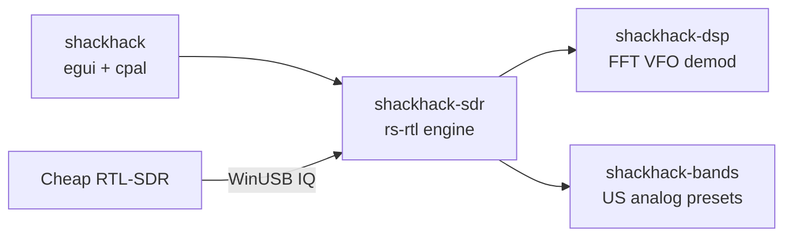

# Drake's Box SDR

**SDR SPIRIT BOX** — RTL-SDR analog ghost box with a night-vision HUD.

Fast software-VFO scan across a band, always-on audio (no squelch), a spectrum analyzer, and eight VFOs walking the live 2.4 MHz window.

Built for a **cheap USB RTL-SDR** (RTL2832U + R820T/R820T2). No upconverter, no GNU Radio, no Airspy.

[](https://github.com/tmdrake/tmdrake-ghostboxSDR/actions/workflows/ci.yml)
[](LICENSE)

<p align="center">
  
</p>
<p align="center"><sub>The whole radio: a few-dollar DVB-T stick, a whip, and this app.</sub></p>

## What it is

Drake's Box SDR is a software ghost box in the line of **Frank Sumption's** ghost box (Frank's Box, 2002). Sumption's radio sweeps a band and leaves the audio open, with no squelch stop. The later Radio Shack "shack hack" is the same idea in a hacked consumer radio. This app does that sweep on a cheap RTL-SDR, but the **tuner stays parked** on a 2.4 MHz chunk and **software VFOs** walk the channels. The PLL only hops when the sweep walks off the window, so tuning looks smooth and the audio click is short.

Default shack-hack: FM broadcast **88–108 MHz**, **WFM**, **150 kHz** steps, **30 ms** dwell, **bounce**, **29.6 dB** gain.

## Look

Dark phosphor screen: spectrum analyzer, eight scanning VFOs, waterfall, a **SCANNING** badge, and an 8-cell **SIG** bar driven by audio RMS.

## Diagram — cheap RTL-SDR to speakers

Antenna in, IQ over USB, parked LO, four VFOs, waterfall and audio out.


The stick captures **~2.4 MHz at once**. Multi-VFO is four software slices of that same window (SDR# Sharp Slicer is Airspy-only).


Retuning the R820T on every 150 kHz step would click. ShackHack keeps the hardware LO still, mixes VFOs in software, crops 10% of each edge (tuner rolloff), and hops only when VFO A walks off the usable 80%. On a hop it drops 1–2 USB buffers and fades audio for a few milliseconds.

## Hardware floor (no upconverter)

| Stick | Range |
|---|---|
| Generic R820T / R820T2 / Nooelec | **~24 MHz – 1766 MHz** |
| Terratec T Stick PLUS (`0ccd:00d7`, E4000) | About **52 MHz – 1700 MHz**. Zero-IF, so the FM sweep works |
| RTL-SDR Blog V4 | **~500 kHz – 1766 MHz** (built-in HF) |

AM broadcast and HF ham need HF (V4 or a V3 in direct sampling). Lowest analog **voice** on a generic stick is **VHF-low 30–50 MHz**. Instantaneous bandwidth is ~2.4 MHz.

Typical cheap kit:

1. USB RTL-SDR dongle (RTL2832U + R820T2)
2. Whip or mag-mount on the SMA
3. Windows PC with WinUSB on **Bulk-In Interface 0** ([WinUSB package](packaging/windows/README.md))

## Gain

The R820T has about **0–49.6 dB** of stepped RF gain. ShackHack exposes it as a **Gain (dB)** slider on the top bar and snaps to the tuner's real steps.

- Start around **25–30 dB**.
- If the NV waterfall goes solid hot-white or you see **OVERLOAD**, drop gain.
- Tuner AGC is not used on FM broadcast; strong stations will slam the ADC.

## Windows driver (WinUSB package)

Windows already ships WinUSB. This package binds that inbox driver to **Bulk-In Interface 0** on the cheap RTL-SDR.

```powershell
powershell -ExecutionPolicy Bypass -File packaging/windows/install-winusb.ps1
```

```powershell
cargo run --release -p shackhack -- --list
cargo run --release -p shackhack -- --setup-driver
```

The package finds the dongle, downloads official Zadig (hash-pinned), and launches it elevated. In Zadig: **Bulk-In, Interface (Interface 0)** → **WinUSB** → Replace Driver. Unplug/replug.

On a normal launch, ShackHack checks the stick. If Interface 0 is not WinUSB, it opens Zadig for you. Windows still shows the admin prompt, and you still click **Replace Driver**. A missing dongle does not open Zadig. `--synth` skips the check.

See [docs/drivers.md](docs/drivers.md), [packaging/windows/README.md](packaging/windows/README.md), and [docs/zadig.md](docs/zadig.md).

## Streaming

ShackHack plays demod audio on the Windows default output. **VB-Audio Virtual Cable** is the streaming path: desktop audio, including the radio, goes into the cable, and the stream captures that cable instead of the microphone.

- Playback default: **CABLE Input (VB-Audio Virtual Cable)**. That is where the desktop audio enters.
- Stream input: **CABLE Output (VB-Audio Virtual Cable)**. Pick this in the streaming app.
- On CABLE Output, turn on **Listen to this device** and send it to the real speakers, so the desk still hears the sweep.
- Leave the real microphone (here, the C920 webcam) as the default recording device. The cable is the desktop-audio source, not the voice mic.

Both ends of the cable are 48 kHz stereo. The driver is donationware from [vb-audio.com](https://vb-audio.com/Cable/) and is not part of this repo.

## Build

Needs Rust (`rustup`) and, on Windows, the MSVC build tools (for `eframe` / `wgpu`).

On Windows, double-click **`Start.vbs`** in this folder. That opens the window. `run.cmd` is the same launcher from a prompt. If Command Prompt is set up to open PowerShell first (`AutoRun`), a plain double-click of `run.cmd` never reaches the script.

```bat
Start.vbs
run.cmd
run.cmd --synth
run.cmd --setup-driver
run.cmd --list
```

```powershell
cargo run --release -p shackhack -- --setup-driver   # once, if the stick is new
cargo run --release -p shackhack
```

No dongle? Fake FM stations:

```powershell
cargo run --release -p shackhack -- --synth
```

## Controls

- **Full range** — sweep from the lowest frequency this stick can tune to the highest. On this E4000 that is about 52 MHz–1700 MHz. The LO hops onto each step so the readout moves. Dwell and demod stay as you set them.
- Gain, volume, band, range, dwell, step, mode, demod, and the VFO checkboxes are saved in `%LOCALAPPDATA%\ShackHack\settings.txt` and restored on the next launch.
- **Band** — FM, airband, VHF, NOAA, GMRS, 70 cm, …
- **Mode** — bounce, forward, backward, random
- **Dwell / Step** — shack-hack speed
- **Gain** — RF gain in dB
- **SIG** — audio-RMS LED bar (green → amber → red)
- Click the spectrum while sweeping to **park VFO 2**
- Stop the scan, then click the spectrum to tune **VFO 1**

## Analog voice presets (US)

See [docs/bands.md](docs/bands.md).

| Preset | MHz | Demod |
|---|---|---|
| FM Broadcast | 88–108 | WFM |
| VHF Low | 30–50 | NFM |
| Airband | 118–137 | AM |
| 2 m ham | 144–148 | NFM |
| NOAA Weather | 162.400–162.550 | NFM |
| GMRS / FRS | 462–467 | NFM |
| AM Broadcast | 0.53–1.70 | AM (needs HF) |

## Repo layout



| Path | What |
|---|---|
| `Start.vbs` | Double-click this to open the radio |
| `run.cmd` | Windows launcher from a prompt (`run.bat` calls it) |
| `crates/shackhack` | Dark HUD, spectrum, gain slider, audio out |
| `crates/shackhack-sdr` | RTL open/hop/gain, synth IQ, radio thread |
| `crates/shackhack-dsp` | FFT, sweeper, AM/NFM/WFM VFOs |
| `crates/shackhack-bands` | Band table and tuner floors |
| `docs/diagrams/` | RTL-SDR photo + architecture SVGs |
| `packaging/windows/` | WinUSB bind package (Zadig, no `.sys` to build) |
| `docs/drivers.md` | Windows WinUSB, E4000, and the Linux/Pi USB notes |
| `docs/zadig.md` | Short WinUSB click-path |
| `docs/bands.md` | Preset notes |
| `docs/roadmap.md` | Linux desktop, then Raspberry Pi 4/5 |

## Later

Windows is the v1 machine. Driver notes for that machine and for a later Pi 4/5 port are in [docs/drivers.md](docs/drivers.md). The order of work is in [docs/roadmap.md](docs/roadmap.md).

## Disclaimer

Receive only. No digital decode, no encryption. Ghost-box / ITC use is entertainment. Check local law before monitoring public-safety radio.

## License

MIT
