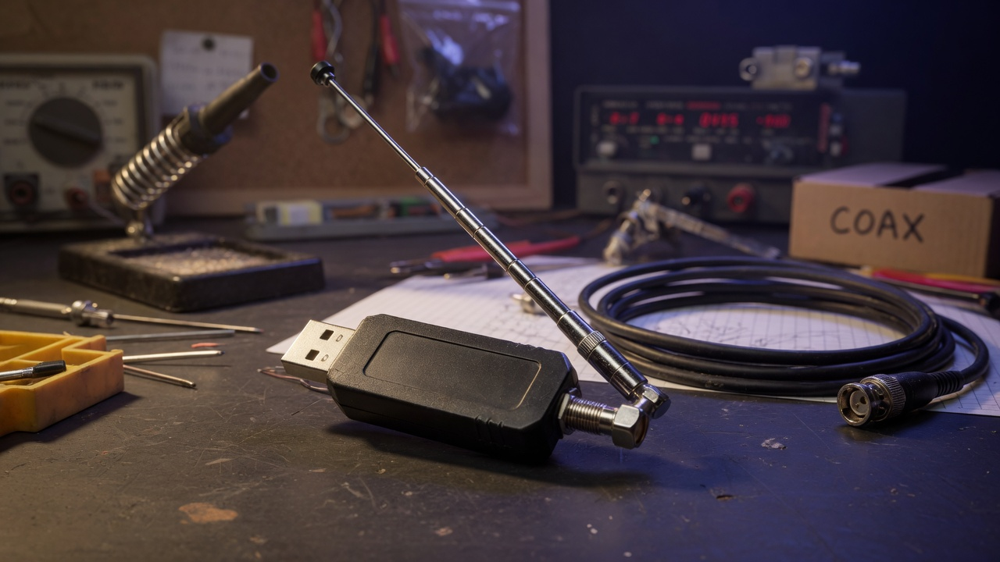
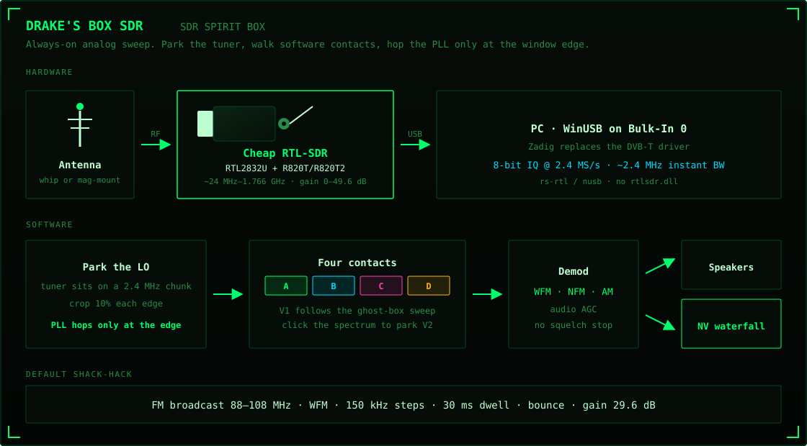
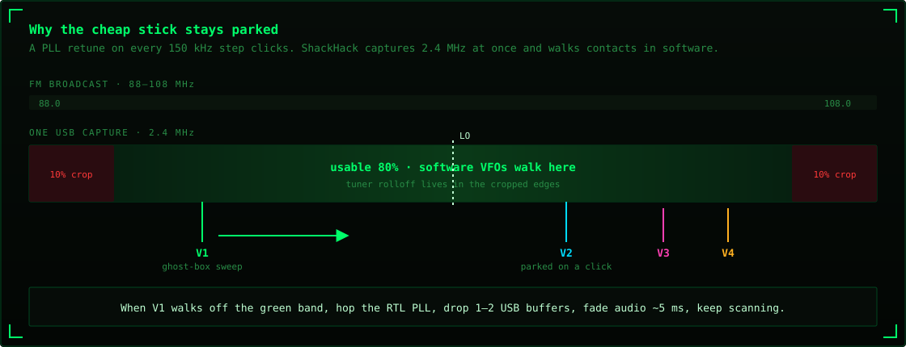
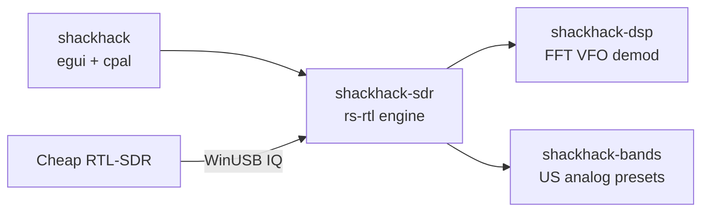

# ShackHack

RTL-SDR analog **ghost box** / shack-hack sweeper. Fast software-VFO scan across a band, always-on audio (no squelch), SDR#-style waterfall, and four VFOs inside the live 2.4 MHz window.

Built for a **cheap USB RTL-SDR** (RTL2832U + R820T/R820T2). No upconverter, no GNU Radio, no Airspy.

[](https://github.com/tmdrake/tmdrake-ghostboxSDR/actions/workflows/ci.yml)
[](LICENSE)

<p align="center">
  
</p>
<p align="center"><sub>The whole radio: a few-dollar DVB-T stick, a whip, and this app.</sub></p>

## What it is

A Radio Shack-style spirit box races through FM and never stops. ShackHack does that on a cheap RTL-SDR, but the **tuner stays parked** on a 2.4 MHz chunk and a **software VFO** walks the channels. The PLL only hops when the sweep walks off the window, so tuning looks smooth and the audio click is short.

Default shack-hack: FM broadcast **88–108 MHz**, **WFM**, **150 kHz** steps, **30 ms** dwell, **bounce**, **29.6 dB** gain.

## Diagram — cheap RTL-SDR to speakers

Antenna in, IQ over USB, parked LO, four VFOs, waterfall and audio out.



The stick captures **~2.4 MHz at once**. Multi-VFO is four software slices of that same window (SDR# Sharp Slicer is Airspy-only).



Retuning the R820T on every 150 kHz step would click. ShackHack keeps the hardware LO still, mixes VFOs in software, crops 10% of each edge (tuner rolloff), and hops only when VFO A walks off the usable 80%. On a hop it drops 1–2 USB buffers and fades audio for a few milliseconds.

## Hardware floor (no upconverter)

| Stick | Range |
|---|---|
| Generic R820T / R820T2 / Nooelec / TerraTec | **~24 MHz – 1766 MHz** |
| RTL-SDR Blog V4 | **~500 kHz – 1766 MHz** (built-in HF) |

AM broadcast and HF ham need HF (V4 or a V3 in direct sampling). Lowest analog **voice** on a generic stick is **VHF-low 30–50 MHz**. Instantaneous bandwidth is ~2.4 MHz.

Typical cheap kit:

1. USB RTL-SDR dongle (RTL2832U + R820T2)
2. Whip or mag-mount on the SMA
3. Windows PC with WinUSB on **Bulk-In Interface 0** ([Zadig](docs/zadig.md))

## Gain

The R820T has about **0–49.6 dB** of stepped RF gain. ShackHack exposes it as a **Gain (dB)** slider on the top bar and snaps to the tuner's real steps.

- Start around **25–30 dB**.
- If the spectrum goes solid yellow/red or you see **OVERLOAD**, drop gain.
- Tuner AGC is not used on FM broadcast; strong stations will slam the ADC.

## Windows driver (Zadig)

The stock DVB-T driver claims the stick. User-space SDR needs WinUSB.

1. Plug in the dongle.
2. Run [Zadig](https://zadig.akeo.ie/) as Administrator.
3. **Options → List All Devices**.
4. Select **Bulk-In, Interface (Interface 0)** (not the composite parent).
5. Target driver: **WinUSB** → Replace Driver.

See [docs/zadig.md](docs/zadig.md).

## Build

Needs Rust (`rustup`) and, on Windows, the MSVC build tools (for `eframe` / `wgpu`).

```powershell
cargo run --release -p shackhack
```

No dongle? Fake FM stations:

```powershell
cargo run --release -p shackhack -- --synth
```

## Controls

- **Sweep / Stop** — ghost-box motion vs listen
- **Band** — FM, airband, VHF, NOAA, GMRS, 70 cm, …
- **Mode** — bounce, forward, backward, random
- **Dwell / Step** — shack-hack speed
- **Gain** — RF gain in dB
- Click the waterfall while sweeping to **park VFO B** on a signal and mix it in
- Stop the sweep, then click to tune **VFO A**

## Analog voice presets (US)

See [docs/bands.md](docs/bands.md).

| Preset | MHz | Demod |
|---|---|---|
| FM Broadcast | 88–108 | WFM |
| VHF Low | 30–50 | NFM |
| Airband | 118–137 | AM |
| 2 m ham | 144–148 | NFM |
| NOAA Weather | 162.400–162.550 | NFM |
| GMRS / FRS | 462–467 | NFM |
| AM Broadcast | 0.53–1.70 | AM (needs HF) |

## Repo layout



| Path | What |
|---|---|
| `crates/shackhack` | Window, waterfall, gain slider, audio out |
| `crates/shackhack-sdr` | RTL open/hop/gain, synth IQ, radio thread |
| `crates/shackhack-dsp` | FFT, sweeper, AM/NFM/WFM VFOs |
| `crates/shackhack-bands` | Band table and tuner floors |
| `docs/diagrams/` | RTL-SDR photo + architecture SVGs |
| `docs/zadig.md` | WinUSB install |
| `docs/bands.md` | Preset notes |

## Disclaimer

Receive only. No digital decode, no encryption. Ghost-box / ITC use is entertainment. Check local law before monitoring public-safety radio.

## License

MIT
