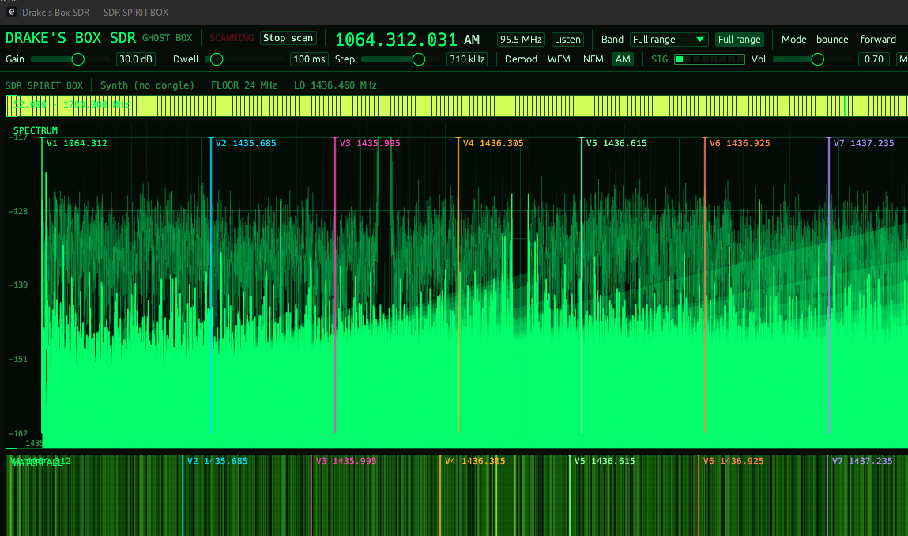
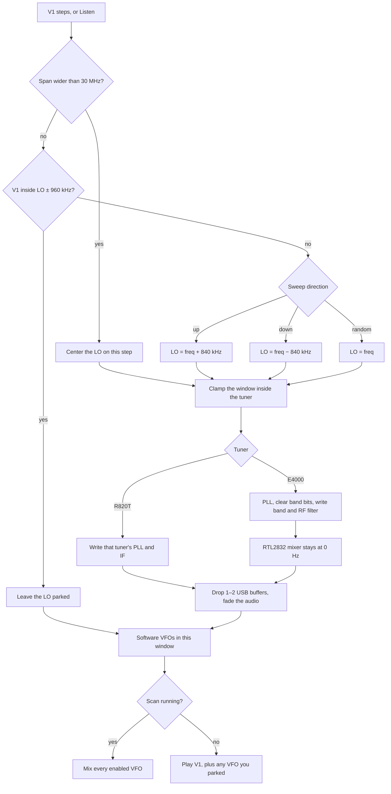
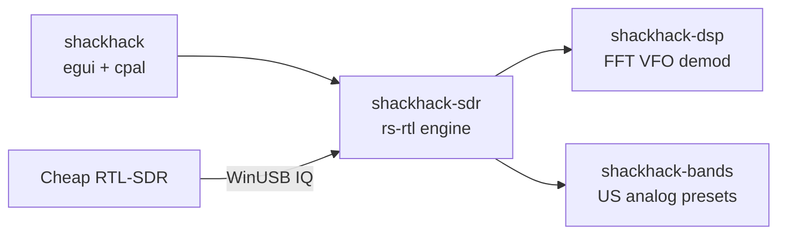

# Drake's Box SDR

**SDR SPIRIT BOX** — RTL-SDR analog ghost box with a night-vision HUD.

Fast software-VFO scan across a band, always-on audio (no squelch), a spectrum analyzer, and eight VFOs walking the live 2.4 MHz window.

Built for a **cheap USB RTL-SDR** (RTL2832U + R820T/R820T2). No upconverter, no GNU Radio, no Airspy.

[](https://github.com/tmdrake/tmdrake-ghostboxSDR/actions/workflows/ci.yml)
[](LICENSE)

<p align="center">
  
</p>
<p align="center"><sub>The whole radio: a few-dollar DVB-T stick, a whip, and this app.</sub></p>

## What it is

Drake's Box SDR is a software ghost box in the line of **Frank Sumption's** ghost box (Frank's Box, 2002). Sumption's radio sweeps a band and leaves the audio open, with no squelch stop. The later Radio Shack "shack hack" is the same idea in a hacked consumer radio. This app does that sweep on a cheap RTL-SDR.

The stick captures **~2.4 MHz at once**. On a normal band (FM, air, marine, NOAA) the **local oscillator stays parked** on that chunk and eight **software VFOs** walk inside it. The PLL hops only when V1 leaves the usable middle 80%, so a short band stays smooth. On a span wider than 30 MHz, including **Full range**, the LO hops onto every step so the readout and the waterfall follow the scan.

Default shack-hack: FM broadcast **88–108 MHz**, **WFM**, **150 kHz** steps, **30 ms** dwell, **bounce**, **29.6 dB** gain. Anything you change is restored from the settings file on the next launch.

## Look

The controls stay night-vision green. The spectrum and the waterfall use the SDR# dark analyzer: a black plot, a gray grid, and a power gradient from black through blue, cyan, green, yellow, and red to white. The trace is an average over a fixed **45 dB** window above the noise, with a yellow peak-hold line, so a weak carrier stays visible next to a louder one. The waterfall is that same LO window and the same gradient. The **LO** number in the status line is the center of both. V1 is the white tuning marker and the station you hear. V2–V8 keep their own colors. A hot column is a station. A blue floor is noise.



This shot is a live stick, scan stopped, V1 parked on **95.500 MHz** WFM. Left to right is the 2.4 MHz window around the LO.

- **V1** is the white cursor. The shaded band is its passband. V2–V8 are the other cursors in the same window. They do not drag the picture with them.
- On a short band the LO stays parked, so the waterfall does not slide while the VFOs walk. On **Full range** the LO hops every step. The number changes. New waterfall rows are the new slice. Old rows stay put until they scroll off, so a real station shows a break, not a smooth sideways slide.
- If the LO number changes and the picture is still the same blue floor, that slice has no carrier. A station is the hot column that shows up in a new left-right place after the hop.
- **Listen** stops the scan and parks V1 on the frequency in the tune box. The dwell slider stops at **500 ms**.

## Diagram — cheap RTL-SDR to speakers

Antenna in, IQ over USB, parked LO on a short band, eight VFOs, waterfall and audio out.


The stick captures **~2.4 MHz at once**. The eight VFOs are software slices of that same window.


Retuning on every small step would click, so a short band keeps the hardware LO still and hops only when V1 walks off the usable 80%. A wide span hops every step instead. Either hop drops 1–2 USB buffers and fades audio for a few milliseconds. 10% of each edge is cropped for tuner rolloff.

## Tuning

At 2.4 MS/s the capture is 2.4 MHz wide. Each edge crops 10%, so a station has to stay inside **LO ± 960 kHz**. Sweeping up, a hop places the LO **840 kHz above** V1 (960 kHz of usable half-width, minus a 120 kHz margin). The walk then runs almost 1.7 MHz before the next click. Sweeping down mirrors that. Random, and any span wider than 30 MHz, centers the LO on the step.

Listen on **95.5 MHz** while the sweep is heading up does not center the dial. It uses the same rule, so the LO lands on **96.340 MHz** and 95.5 sits just inside the low edge.



The E4000 IF filters are not rewritten on every hop. Opening the dongle sets them to the sample rate (about 2.4 MHz) and leaves the chip in zero-IF. FM is VHF, so the RF filter on that hop is the VHF slot. The stick's own range is about **52–1700 MHz**.

## Hardware floor (no upconverter)

| Stick | Range |
|---|---|
| Generic R820T / R820T2 / Nooelec | **~24 MHz – 1766 MHz** |
| Terratec T Stick PLUS (`0ccd:00d7`, E4000) | About **52 MHz – 1700 MHz**. Zero-IF, so the FM sweep works |
| RTL-SDR Blog V4 | **~500 kHz – 1766 MHz** (built-in HF) |

AM broadcast and HF ham need HF (V4 or a V3 in direct sampling). Lowest analog **voice** on a generic stick is **VHF-low 30–50 MHz**. Instantaneous bandwidth is ~2.4 MHz.

Typical cheap kit:

1. USB RTL-SDR dongle (RTL2832U + R820T2)
2. Whip or mag-mount on the SMA
3. Windows PC with WinUSB on **Bulk-In Interface 0** ([WinUSB package](packaging/windows/README.md))

## Gain

The **Gain** slider is manual. Tuner AGC stays off.

- **R820T / R820T2:** about **0–49.6 dB**, snapped to the tuner's real steps. Start around **25–30 dB**.
- **E4000** (this Terratec `0ccd:00d7`): slider steps from **−1.0 to 42.0 dB**. That number is the LNA plus the mixer. The six IF stages stay at the fixed moderate setting and are not on the slider. Broadcast FM on this stick was clean around **11.5 dB**. The default **29.6 dB** is the weak-signal mark and will overload a local station.
- If the waterfall pins solid hot-white or you see **OVERLOAD**, drop gain. A pinned trace hides weak stations the same way too little gain does.

## Windows driver (WinUSB package)

Windows already ships WinUSB. This package binds that inbox driver to **Bulk-In Interface 0** on the cheap RTL-SDR.

```powershell
powershell -ExecutionPolicy Bypass -File packaging/windows/install-winusb.ps1
```

```powershell
cargo run --release -p shackhack -- --list
cargo run --release -p shackhack -- --setup-driver
```

The package finds the dongle, downloads official Zadig (hash-pinned), and launches it elevated. In Zadig: **Bulk-In, Interface (Interface 0)** → **WinUSB** → Replace Driver. Unplug/replug.

On a normal launch, ShackHack checks the stick. If Interface 0 is not WinUSB, it opens Zadig for you. Windows still shows the admin prompt, and you still click **Replace Driver**. A missing dongle does not open Zadig. `--synth` skips the check.

See [docs/drivers.md](docs/drivers.md), [packaging/windows/README.md](packaging/windows/README.md), and [docs/zadig.md](docs/zadig.md).

## Streaming

ShackHack plays demod audio on the Windows default output. **VB-Audio Virtual Cable** is the streaming path: desktop audio, including the radio, goes into the cable, and the stream captures that cable instead of the microphone.

- Playback default: **CABLE Input (VB-Audio Virtual Cable)**. That is where the desktop audio enters.
- Stream input: **CABLE Output (VB-Audio Virtual Cable)**. Pick this in the streaming app.
- On CABLE Output, turn on **Listen to this device** and send it to the real speakers, so the desk still hears the sweep.
- Leave the real microphone (here, the C920 webcam) as the default recording device. The cable is the desktop-audio source, not the voice mic.

Both ends of the cable are 48 kHz stereo. The driver is donationware from [vb-audio.com](https://vb-audio.com/Cable/) and is not part of this repo.

## Build

Needs Rust (`rustup`) and, on Windows, the MSVC build tools (for `eframe` / `wgpu`).

On Windows, double-click **`Start.vbs`** in this folder. That opens the window. `run.cmd` is the same launcher from a prompt. If Command Prompt is set up to open PowerShell first (`AutoRun`), a plain double-click of `run.cmd` never reaches the script.

```bat
Start.vbs
run.cmd
run.cmd --synth
run.cmd --setup-driver
run.cmd --list
```

```powershell
cargo run --release -p shackhack -- --setup-driver   # once, if the stick is new
cargo run --release -p shackhack
```

No dongle? Fake FM stations:

```powershell
cargo run --release -p shackhack -- --synth
```

## Controls

The scan starts on open. **Stop scan** means it is already moving. **Start scan** means it is held.

- **Listen** — type a frequency (the box opens on **95.5**) and park **V1** there. The scan stops, mute turns off, and a broadcast-FM frequency forces wide FM. The LO hops so that frequency is in the window.
- **Full range** — sweep from the lowest frequency this stick can tune to the highest. This E4000 is about **52–1700 MHz**. A generic R820T is about **24–1766 MHz**. A Blog V4 starts at **500 kHz**. The LO hops on every step. Dwell and demod are left as you set them. If the step is still under 100 kHz, Full range raises it to 250 kHz so a pass is minutes, not an hour.
- **Band** — FM, airband, marine, NOAA, GMRS, 70 cm, …
- **Mode** — bounce, forward, backward, random. Random jumps the LO around. Forward or bounce is the readable sweep.
- **Dwell** — 10–500 ms on each step. **Step** — channel spacing in kHz.
- **Out** — playback device. Pick **CABLE Input (VB-Audio Virtual Cable)** to feed StreamYard. StreamYard's mic is **CABLE Output**, the other end of that cable. The choice is saved.
- **Gain** — RF gain in dB. **AGC** turns the tuner AGC on or off and is saved. Off is the default: **OVERLOAD** means the slider is too high and nothing will turn it down. The slow audio leveler after the demod stays on either way. **Vol** and **Mute**. **SIG** — audio-RMS LED bar (green → amber → red).
- Click the spectrum while scanning to **park V2**. Stop the scan, then click to tune **V1**.

Settings are restored on the next launch: gain, volume, mute, band, custom range, full range, dwell, step, mode, demod, scan on/off, and each VFO's checkbox and mix.

- Windows: `%LOCALAPPDATA%\ShackHack\settings.txt`
- Linux: `~/.local/share/ShackHack/settings.txt`

## Analog voice presets (US)

See [docs/bands.md](docs/bands.md).

| Preset | MHz | Demod |
|---|---|---|
| FM Broadcast | 88–108 | WFM |
| VHF Low | 30–50 | NFM |
| Airband | 118–137 | AM |
| 2 m ham | 144–148 | NFM |
| NOAA Weather | 162.400–162.550 | NFM |
| GMRS / FRS | 462–467 | NFM |
| AM Broadcast | 0.53–1.70 | AM (needs HF) |

## Repo layout



| Path | What |
|---|---|
| `Start.vbs` | Double-click this to open the radio |
| `run.cmd` | Windows launcher from a prompt (`run.bat` calls it) |
| `crates/shackhack` | Dark HUD, spectrum, gain slider, audio out |
| `crates/shackhack-sdr` | RTL open/hop/gain, synth IQ, radio thread |
| `crates/shackhack-dsp` | FFT, sweeper, AM/NFM/WFM VFOs |
| `crates/shackhack-bands` | Band table and tuner floors |
| `docs/diagrams/` | RTL-SDR photo + architecture SVGs |
| `docs/screenshots/radio.png` | Window grab of a live FM listen |
| `packaging/windows/` | WinUSB bind package (Zadig, no `.sys` to build) |
| `docs/drivers.md` | Windows WinUSB, E4000, and the Linux/Pi USB notes |
| `docs/zadig.md` | Short WinUSB click-path |
| `docs/bands.md` | Preset notes |
| `docs/roadmap.md` | Linux desktop, then Raspberry Pi 4/5 |

## Later

Windows is the v1 machine. Driver notes for that machine and for a later Pi 4/5 port are in [docs/drivers.md](docs/drivers.md). The order of work is in [docs/roadmap.md](docs/roadmap.md).

## Disclaimer

Receive only. No digital decode, no encryption. Ghost-box / ITC use is entertainment. Check local law before monitoring public-safety radio.

## License

MIT
