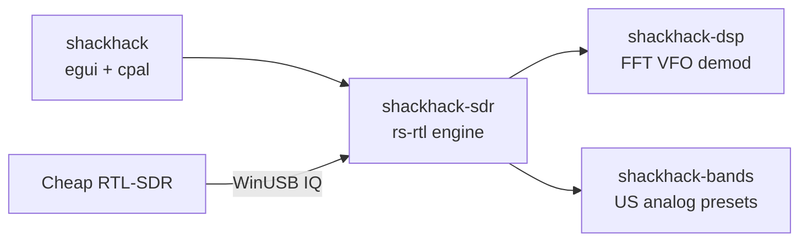

# ShackHack

**SLS SPIRIT BOX** — RTL-SDR analog ghost box with a night-vision investigator HUD.

Fast software-VFO scan across a band, always-on audio (no squelch), phosphor waterfall, and four glowing **contacts** (ENT A–D) inside the live 2.4 MHz window.

Built for a **cheap USB RTL-SDR** (RTL2832U + R820T/R820T2). No upconverter, no GNU Radio, no Airspy.

[](https://github.com/tmdrake/tmdrake-ghostboxSDR/actions/workflows/ci.yml)
[](LICENSE)

<p align="center">
  
</p>
<p align="center">
  
</p>
<p align="center"><sub>The whole radio: a few-dollar DVB-T stick, a whip, and this app.</sub></p>

## What it is

A Radio Shack-style spirit box races through FM and never stops. ShackHack does that on a cheap RTL-SDR, but the **tuner stays parked** on a 2.4 MHz chunk and a **software VFO** walks the channels. The PLL only hops when the sweep walks off the window, so tuning looks smooth and the audio click is short.

Default shack-hack: FM broadcast **88–108 MHz**, **WFM**, **150 kHz** steps, **30 ms** dwell, **bounce**, **29.6 dB** gain.

## Look

Night-vision phosphor HUD in the spirit of an SLS camera kit: dark viewfinder, glowing stick-figure **contacts** on the sweep field, NV waterfall, blinking **SWEEP LIVE**, and an 8-cell **SIG** bar driven by audio RMS. Original ShackHack branding.

## Diagram — cheap RTL-SDR to speakers

Antenna in, IQ over USB, parked LO, four VFOs, waterfall and audio out.


The stick captures **~2.4 MHz at once**. Multi-VFO is four software slices of that same window (SDR# Sharp Slicer is Airspy-only).


Retuning the R820T on every 150 kHz step would click. ShackHack keeps the hardware LO still, mixes VFOs in software, crops 10% of each edge (tuner rolloff), and hops only when VFO A walks off the usable 80%. On a hop it drops 1–2 USB buffers and fades audio for a few milliseconds.

## Hardware floor (no upconverter)

| Stick | Range |
|---|---|
| Generic R820T / R820T2 / Nooelec / TerraTec | **~24 MHz – 1766 MHz** |
| RTL-SDR Blog V4 | **~500 kHz – 1766 MHz** (built-in HF) |

AM broadcast and HF ham need HF (V4 or a V3 in direct sampling). Lowest analog **voice** on a generic stick is **VHF-low 30–50 MHz**. Instantaneous bandwidth is ~2.4 MHz.

Typical cheap kit:

1. USB RTL-SDR dongle (RTL2832U + R820T2)
2. Whip or mag-mount on the SMA
3. Windows PC with WinUSB on **Bulk-In Interface 0** ([WinUSB package](packaging/windows/README.md))

## Gain

The R820T has about **0–49.6 dB** of stepped RF gain. ShackHack exposes it as a **Gain (dB)** slider on the top bar and snaps to the tuner's real steps.

- Start around **25–30 dB**.
- If the NV waterfall goes solid hot-white or you see **OVERLOAD**, drop gain.
- Tuner AGC is not used on FM broadcast; strong stations will slam the ADC.

## Windows driver (WinUSB package)

Windows already ships WinUSB. This package binds that inbox driver to **Bulk-In Interface 0** on the cheap RTL-SDR.

```powershell
powershell -ExecutionPolicy Bypass -File packaging/windows/install-winusb.ps1
```

```powershell
cargo run --release -p shackhack -- --list
cargo run --release -p shackhack -- --setup-driver
```

The package finds the dongle, downloads official Zadig (hash-pinned), and launches it elevated. In Zadig: **Bulk-In, Interface (Interface 0)** → **WinUSB** → Replace Driver. Unplug/replug.

On a normal launch, ShackHack checks the stick. If Interface 0 is not WinUSB, it opens Zadig for you. Windows still shows the admin prompt, and you still click **Replace Driver**. A missing dongle does not open Zadig. `--synth` skips the check.

See [packaging/windows/README.md](packaging/windows/README.md) and [docs/zadig.md](docs/zadig.md).

## Build

Needs Rust (`rustup`) and, on Windows, the MSVC build tools (for `eframe` / `wgpu`).

On Windows, double-click `run.cmd` (or `run.bat`, which calls it). That starts the window directly. Flags still pass through:

```bat
run.cmd
run.cmd --synth
run.cmd --setup-driver
run.cmd --list
```

```powershell
cargo run --release -p shackhack -- --setup-driver   # once, if the stick is new
cargo run --release -p shackhack
```

No dongle? Fake FM stations:

```powershell
cargo run --release -p shackhack -- --synth
```

## Controls

- **HOLD / SWEEP** — freeze the box vs keep racing
- **Band** — FM, airband, VHF, NOAA, GMRS, 70 cm, …
- **Mode** — bounce, forward, backward, random
- **Dwell / Step** — shack-hack speed
- **Gain** — RF gain in dB
- **SIG** — audio-RMS LED bar (green → amber → red)
- Click the sweep field while sweeping to **park ENT B** on a signal and mix it in
- HOLD the sweep, then click to tune **ENT A**

## Analog voice presets (US)

See [docs/bands.md](docs/bands.md).

| Preset | MHz | Demod |
|---|---|---|
| FM Broadcast | 88–108 | WFM |
| VHF Low | 30–50 | NFM |
| Airband | 118–137 | AM |
| 2 m ham | 144–148 | NFM |
| NOAA Weather | 162.400–162.550 | NFM |
| GMRS / FRS | 462–467 | NFM |
| AM Broadcast | 0.53–1.70 | AM (needs HF) |

## Repo layout



| Path | What |
|---|---|
| `run.cmd` | Windows launcher (opens the release window; `run.bat` calls it) |
| `crates/shackhack` | SLS HUD, NV waterfall, gain slider, audio out |
| `crates/shackhack/assets/` | Window icon (phosphor stick figure) |
| `crates/shackhack-sdr` | RTL open/hop/gain, synth IQ, radio thread |
| `crates/shackhack-dsp` | FFT, sweeper, AM/NFM/WFM VFOs |
| `crates/shackhack-bands` | Band table and tuner floors |
| `docs/diagrams/` | RTL-SDR photo + architecture SVGs |
| `packaging/windows/` | WinUSB bind package (Zadig, no `.sys` to build) |
| `docs/zadig.md` | Driver notes |
| `docs/bands.md` | Preset notes |
| `docs/roadmap.md` | Linux desktop, then Raspberry Pi |

## Later

Windows is the v1 machine. A Linux desktop package (udev, no WinUSB) comes before a Raspberry Pi 4/5 build. See [docs/roadmap.md](docs/roadmap.md).

## Disclaimer

Receive only. No digital decode, no encryption. Ghost-box / ITC use is entertainment. Check local law before monitoring public-safety radio.

## License

MIT
